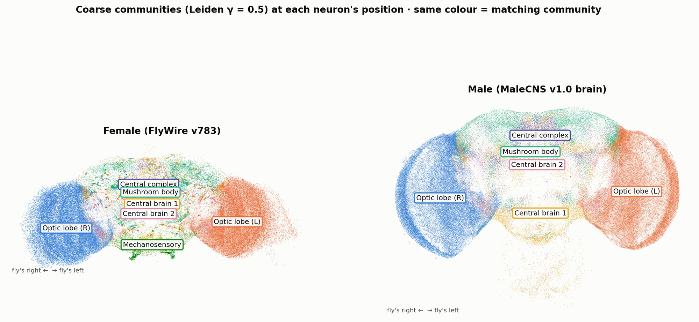

# Relatório

> [!CAUTION]
>
> - Você <ins>**não**</ins> **pode utilizar ferramentas de IA para escrever este relatório**.

## Identificação

- **Nome**: <mark>`Alisson Oliveira de Siqueira`</mark>
- **Cartão UFRGS:** <mark>`577351`</mark>

## Dados utilizados

> [!IMPORTANT]
>
> - Os dados utilizados devem ser informados como **links** para as fontes originais.
> - Se houver mais de um conjunto de dados, liste todos separadamente.
> - Para cada conjunto de dados, inclua também uma **descrição curta** explicando os dados.

1. **Dataset 1**: <mark>`Drosophila Conectome`</mark>
    * **Descrição curta**: <mark>`Conectoma da Mosca-da-Fruta (Drosófila) macho, onde cada nodo é um neurônio e cada conexão uma sinapse`</mark>
2. **Dataset 2**: <mark>`FlyWire Conectome`</mark>
    * **Descrição curta**: <mark>`Conectoma da Mosca-da-Fruta fêmea, cada nodo é um neurônio e cada conexão uma sinapse`</mark>
3. ...

## Código-fonte da visualização

> [!IMPORTANT]
>
> - Indique abaixo onde está, dentro deste repositório, o código-fonte usado para gerar a visualização.

- **Arquivo principal**: <mark>`<preencher>`</mark>
- **Arquivos complementares (se houver)**: <mark>`<preencher>`</mark>

## Imagem da visualização gerada

> [!IMPORTANT]
>
> - Insira aqui uma imagem da visualização criada por você. Troque `imagem-da-visualizacao.png` pelo caminho correto do arquivo no repositório. 
> - Se você criou alguma visualização interativa, então descreva aqui como acessá-la. Por exemplo, se for uma página HTML, coloque o link, ou se for uma visualização 3D, descreva como compilar e executar o código. 

<mark>`<preencher abaixo>`</mark>

## Descrição da visualização

### Legenda (*caption*)

> [!IMPORTANT]
>
> - Escreva um texto curto explicando como interpretar a visualização. Descreva os elementos visuais, eixos, cores, símbolos ou interações relevantes.
> - Este texto seria a legenda (*caption*) que acompanharia a figura em uma publicação, por exemplo.

<mark>`Cada cor é uma comunidade (usando o algoritmo de Leiden de detecção de comunidade em grafos), cada nodo é um neurônio em sua respectiva posição. As legendas em cima das comunidades são os nomes das mesmas dado a partir da análise dos tipos de neurônios prevalentes naquela comunidade (Comunidade com prevalência de neurônio do tipo visual é interpretado como um dos lobos ópticos, por exemplo).`</mark>

### Conclusão demonstrada pela visualização

> [!IMPORTANT]
>
> - Escreva uma conclusão curta sobre os dados com base na visualização.
> - Explique qual insight, padrão ou tendência pode ser observado.

<mark>`O cérebro de uma Mosca-da-Fruta é organizado de forma extremamente modular, e cada comunidade da rede construida a partir do conectoma corresponde quase que perfeitamente a uma região do cérebro.`</mark>
